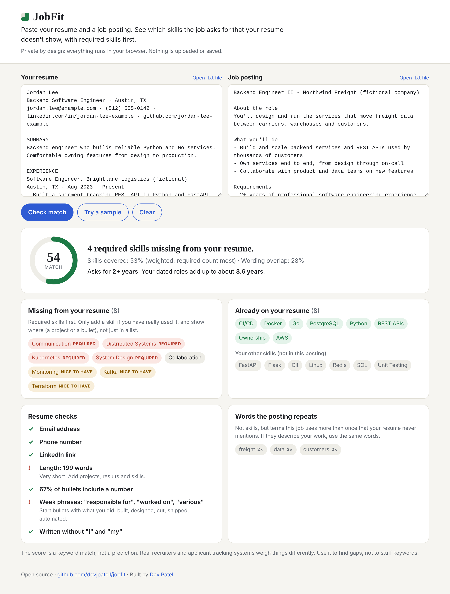

# JobFit

**Paste your resume and a job posting. See which skills the job asks for that your resume doesn't show, with required skills first.**

Free, private, and it runs entirely in your browser. Nothing is uploaded, stored, or sent anywhere.

**Try it:** https://devjpatell.github.io/jobfit/



## Why I built it

Every job application asks the same question: does my resume actually show what this posting wants? Doing that comparison by hand for every job is slow and easy to get wrong. The tools that do it for you usually want an account, an email address, or a copy of your resume on their servers. I wanted one that is instant and keeps your data on your own machine.

## What it shows

- **Missing skills, ranked.** Skills under "Requirements" or "Must have" are marked *required* and listed first. Skills under "Nice to have" or "Preferred" come after. Skills mentioned several times count more.
- **Skills you already cover**, plus skills on your resume this posting doesn't ask for.
- **Experience check.** Reads "2+ years", "3-5 years" or "minimum of 4 years" from the posting and adds up the dated roles on your resume (overlapping roles are merged, "Present" counts up to today).
- **Resume checks.** Contact details, length, how many bullets include a number, weak phrases like "responsible for" or "worked on", and first-person writing.
- **Words the posting repeats** that never appear in your resume.
- **A match score** from 0 to 100: 75% weighted skill coverage, 25% wording overlap.

## How the matching works

- A dictionary of over 100 skills with their aliases (`k8s` → Kubernetes, `Postgres` → PostgreSQL, `sklearn` → scikit-learn), in [`src/skills.js`](src/skills.js).
- Whole-word matching that understands symbols, so `C#`, `C++` and `.NET` match correctly and `Java` never matches inside `JavaScript`.
- Everyday words only count when written the way engineers write them: "REST API" counts, "the rest of" doesn't; "Go" counts, "let's go" doesn't.
- Section detection: headings like "Requirements", "Nice to have" and "Bonus" set the importance of every skill under them. A line that says "is a plus" is optional even inside a requirements list.
- Wording overlap uses cosine similarity of term-frequency vectors, with common filler words removed.

All of the logic is in pure functions in [`src/analyzer.js`](src/analyzer.js), with no browser code, so the same code runs in the page and in the tests.

## Run it locally

No build step and no dependencies.

```bash
git clone https://github.com/devjpatell/jobfit
cd jobfit
python3 -m http.server 8000     # or any static file server
# open http://localhost:8000
```

Run the tests (Node 18+):

```bash
npm test
```

## Limitations

- The score is a keyword match, not a prediction of whether you'll get an interview. Recruiters and applicant tracking systems weigh things differently.
- It only knows the skills in its dictionary. A niche tool that isn't listed won't be detected. Adding one is a one-line change in `src/skills.js`.
- PDF files aren't read directly yet. Open the PDF, select all, copy, and paste.

## Ideas for next steps

- Read PDF and DOCX files in the browser
- Suggest where on the resume a missing skill could go, based on matching bullets
- Domain dictionaries beyond software (data analysis, design, healthcare)

The sample resume and job posting use fictional people and companies.

## License

MIT
